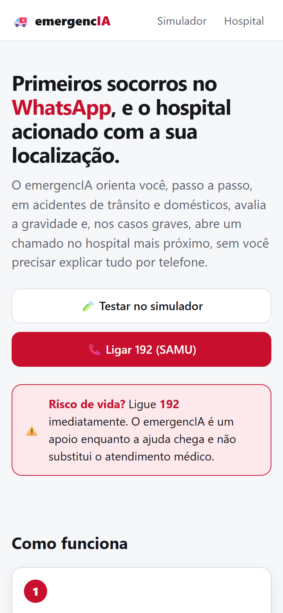
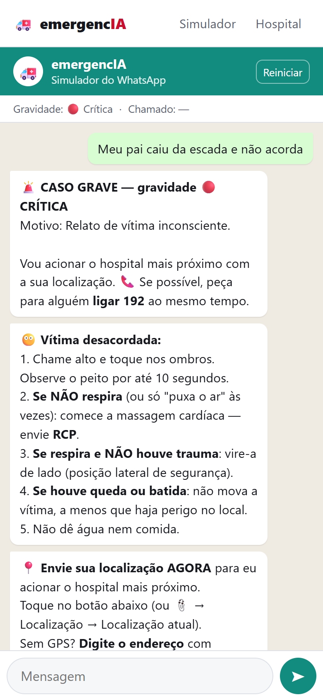
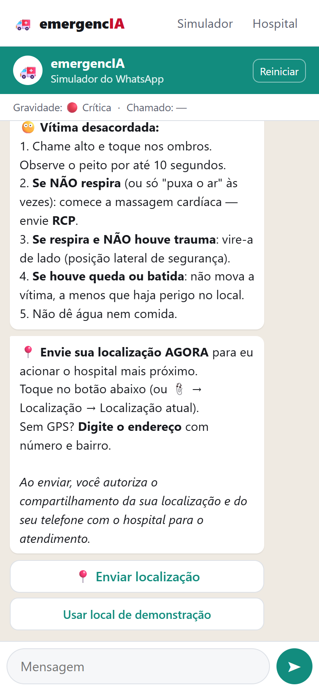
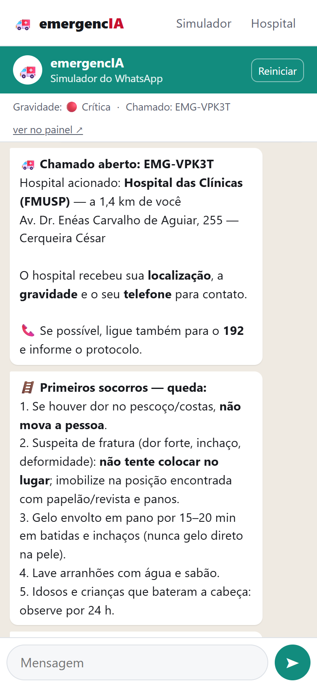
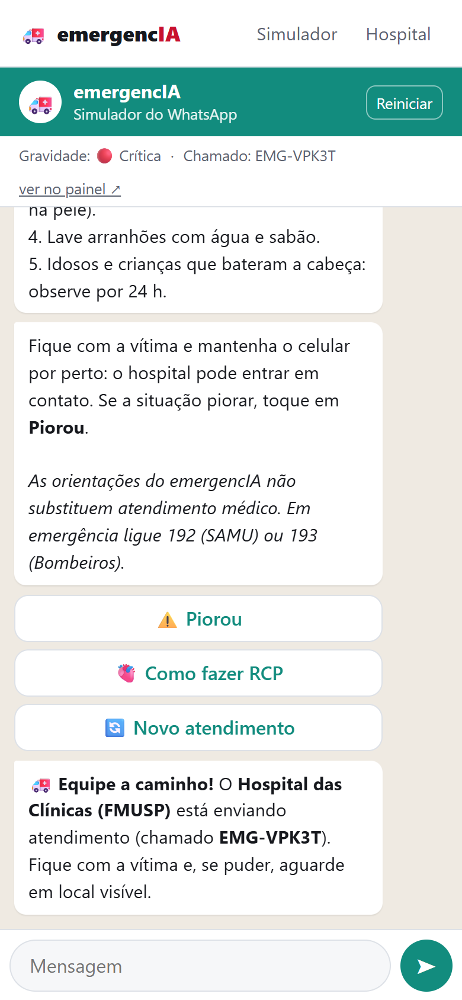
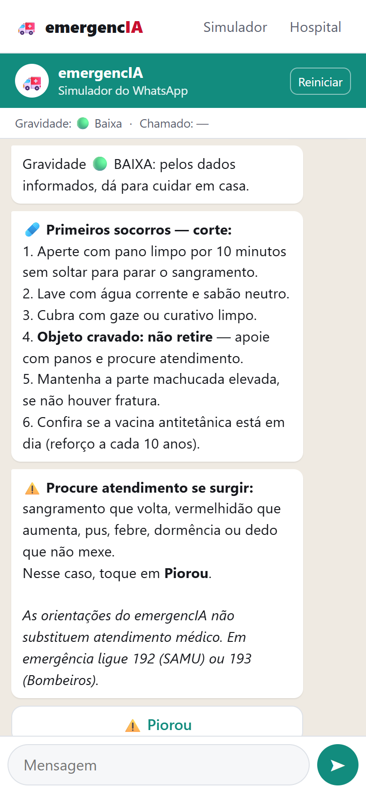
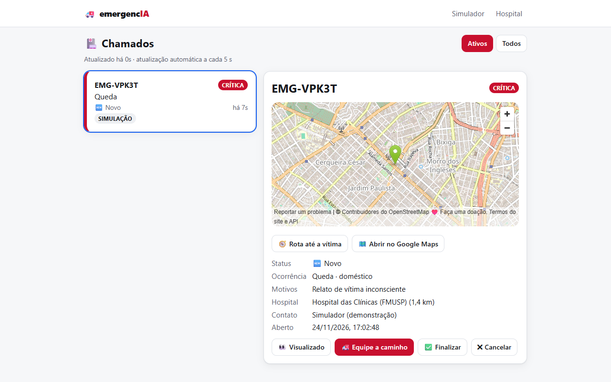

<p align="center">
  
</p>

<h1 align="center">emergencIA</h1>

<p align="center">
  <strong>Primeiros socorros no WhatsApp, e o hospital mais próximo acionado com a localização da vítima.</strong><br>
  FMU Tech Inovação 2026.2 · Projeto acadêmico · ODS 3 (Saúde e bem-estar)
</p>

<p align="center">
  <a href="#protótipo">Protótipo</a> ·
  <a href="#como-executar">Como executar</a> ·
  <a href="#1-descrição-do-problema">Problema</a> ·
  <a href="#2-proposta-de-solução-tecnológica">Solução</a> ·
  <a href="#3-identidade-visual">Identidade visual</a> ·
  <a href="#4-pitch">Pitch</a> ·
  <a href="#5-equipe">Equipe</a> ·
  <a href="#6-organização-do-repositório">Repositório</a>
</p>

<p align="center">
  <a href="https://emergenc-ia-gules.vercel.app"><strong>▶ Abrir o app</strong></a> ·
  <a href="https://emergenc-ia-gules.vercel.app/simulador"><strong>💬 Testar no simulador</strong></a> ·
  <a href="docs/demo/emergencia-demo.mp4"><strong>🎬 Vídeo de demonstração (2 min)</strong></a>
</p>

> [!WARNING]
> As orientações do emergencIA **não substituem atendimento médico**. Em emergência, ligue
> **192** (SAMU) ou **193** (Bombeiros).

---

## Status

| Fase | Concluídas | Situação |
|------|-----------|----------|
| F0 Fundação | 5/5 | ✅ |
| F1 Núcleo de triagem e conversa | 6/6 | ✅ |
| F2 Geolocalização, persistência e chamados | 8/8 | ✅ |
| F3 Integração WhatsApp | 5/7 | 🟡 Código pronto; falta o teste de ponta a ponta com a conta Meta da equipe |
| F4 Web mobile (PWA) | 7/7 | ✅ |
| **F5 Deploy e documentação** | 4/6 | 🟡 **No ar na Vercel com Upstash Redis**; faltam as variáveis e o webhook do WhatsApp |
| F6 Apresentação | 3/6 | 🟡 Roteiro pronto; faltam o texto do edital e os slides |
| **MVP** | **38/45** | **113 testes automatizados passando** |

Checklist completo, com o critério de pronto de cada tarefa, em
[development_plan.md](development_plan.md#4-tarefas-por-fase).

---

## Protótipo

O emergencIA é um **chatbot de WhatsApp** com uma **aplicação web mobile (PWA)** de apoio. O
protótipo **executa o fluxo principal de ponta a ponta**: a pessoa descreve o acidente, recebe as
orientações, envia a localização e o hospital mais próximo recebe o chamado no painel.

| Etapa | O que acontece |
|---|---|
| **1. Relato** | A pessoa escreve com as próprias palavras ("meu pai caiu da escada e não acorda") ou navega pelos botões *Trânsito / Em casa* |
| **2. Triagem** | O bot identifica o tipo de acidente e os sinais de alerta. Sinais críticos (não respira, desacordado, sangramento intenso, convulsão, suspeita de infarto, presos nas ferragens…) **pulam as perguntas** e vão direto para a gravidade 🔴 crítica |
| **3. Orientação** | Instruções imediatas e o passo a passo de primeiros socorros do tipo de acidente (RCP, desengasgo, sangramento, queimadura…) |
| **4. Localização** | Nos casos graves, o bot pede o 📍, com consentimento explícito para compartilhar localização e telefone com o hospital. Sem GPS, aceita o endereço digitado |
| **5. Chamado** | O hospital com pronto-socorro mais próximo recebe o chamado `EMG-XXXXX` com gravidade, tipo, motivos, mapa e contato |
| **6. Resposta** | O hospital marca **🚑 Equipe a caminho** no painel e a pessoa é avisada no WhatsApp na mesma hora |

| Gravidade | O que o bot faz |
|-----------|-----------------|
| 🔴 Crítica | Instruções que salvam vidas (RCP, Heimlich, sangramento…) e **chamado automático** |
| 🟠 Alta | **Chamado automático** e passo a passo |
| 🟡 Moderada | Orientação e indicação dos pronto-socorros mais próximos, com rota |
| 🟢 Baixa | Cuidados em casa e sinais de alerta (o botão "Piorou" aciona o hospital) |

**Situações cobertas (11):** batida de carro, moto/bicicleta, atropelamento, queda, queimadura,
corte, engasgo, choque elétrico, intoxicação, afogamento e outros.

| Página | Para quê |
|--------|----------|
| [`/`](https://emergenc-ia-gules.vercel.app) | Página inicial: botões "Testar no simulador", "Ligar 192" e "Falar no WhatsApp" (este aparece quando `NEXT_PUBLIC_WHATSAPP_NUMBER` está definido) |
| [`/simulador`](https://emergenc-ia-gules.vercel.app/simulador) | Conversa idêntica à do WhatsApp, no navegador (para testar sem a conta da Meta) |
| [`/hospital`](https://emergenc-ia-gules.vercel.app/hospital) | Painel de chamados do hospital, protegido por senha |
| [`/api/health`](https://emergenc-ia-gules.vercel.app/api/health) | Diagnóstico da configuração (sem expor segredos) |

### Prints

| Página inicial | Triagem (caso grave) | Pedido de localização |
|---|---|---|
|  |  |  |

| Chamado aberto | Equipe a caminho | Caso leve |
|---|---|---|
|  |  |  |

**Painel do hospital** (o chamado chega em até 5 s, com mapa, rota, motivos e botões de status):



### Segurança, privacidade e acessibilidade

| Diretriz | No protótipo |
|---|---|
| Consentimento (LGPD) | A localização só é pedida com aviso explícito de que será compartilhada com o hospital |
| Dados mínimos e expiração | Só telefone, localização e respostas da triagem. Sessões expiram em **24 h** e chamados em **30 dias** (TTL no Redis) |
| Painel protegido | `/hospital` e as APIs de chamados exigem o `DASHBOARD_TOKEN` |
| Webhook autenticado | Toda mensagem da Meta tem a assinatura `X-Hub-Signature-256` validada (HMAC-SHA256, comparação em tempo constante) e é deduplicada pelo `message.id` |
| Decisões explicáveis | A triagem é um sistema de regras: cada gravidade aponta o motivo ("Relato de vítima inconsciente") |
| Sempre o 192 | Todo caso grave reforça "ligue 192", e toda orientação final traz o aviso legal |
| Não depende só de cor | A gravidade aparece com cor **+ emoji + palavra** (🔴 Crítica) |
| Acesso | Mobile-first, tema claro e escuro automático, foco visível no teclado, botões principais com 48 px de altura, `aria-live` nas mensagens do chat e no painel |
| Leve no 4G | CSS puro, sem bibliotecas de UI; instalável na tela inicial (PWA) |

### O que é provisório nesta versão

| Item | No protótipo | Evolução prevista |
|---|---|---|
| Base de hospitais | 10 hospitais com pronto-socorro em São Paulo, coordenadas aproximadas ([`src/data/hospitals.ts`](src/data/hospitals.ts)) | Base oficial do CNES/DataSUS e filtro por especialidade (queimados, trauma, pediatria) |
| WhatsApp | Código pronto e testado; conta Meta da equipe ainda não ligada | Número de teste da Meta → verificação do negócio para uso real |
| Entendimento de texto | Palavras-chave e regras | IA generativa (Claude) só para interpretar texto livre e áudio, com as regras como rede de segurança |
| Conteúdo de primeiros socorros | Baseado em materiais públicos (Ministério da Saúde/SAMU, Cruz Vermelha, diretrizes de RCP da AHA) | **Revisão por profissional de saúde antes de qualquer uso real** |
| "Chamado ao hospital" | Painel para hospitais parceiros, com aviso opcional por WhatsApp ou webhook | Integração com a Central de Regulação do SAMU 192, que exige convênio com o poder público |

---

## Documentação

| Documento | Conteúdo | Situação |
|---|---|---|
| [docs/PROPOSTA.md](docs/PROPOSTA.md) | Proposta enviada ao FMU Tech Inovação (problema, público, bases de dados públicas, solução) | ✅ |
| [development_plan.md](development_plan.md) | Plano de desenvolvimento: arquitetura, stack, fases com checklist, estimativas, testes e deploy | ✅ Atualizado a cada etapa |
| [docs/DEPLOY_VERCEL.md](docs/DEPLOY_VERCEL.md) | **Passo a passo de deploy na Vercel, Upstash Redis e WhatsApp** | ✅ |
| [docs/API.md](docs/API.md) | Referência de todas as rotas de API | ✅ |
| [docs/ARQUITETURA.md](docs/ARQUITETURA.md) | Guia do código, decisões técnicas e como estender | ✅ |
| [docs/APRESENTACAO.md](docs/APRESENTACAO.md) | Roteiro da apresentação, demo ao vivo com plano B e perguntas da banca | 📝 Falta alinhar aos itens 2 e 4 do edital |
| [docs/demo/emergencia-demo.mp4](docs/demo/emergencia-demo.mp4) | Vídeo de demonstração (2 min): caso grave com chamado ao hospital e caso leve | ✅ No simulador; falta a versão no WhatsApp real |
| [.env.example](.env.example) | Todas as variáveis de ambiente, comentadas | ✅ |

---

## Como executar

**Pré-requisito:** [Node.js](https://nodejs.org) 20 ou mais recente.

```bash
git clone https://github.com/pedroparosc/emergencIA.git
cd emergencIA
npm install
npm run dev
```

Abra http://localhost:3000. **Sem nenhuma configuração** o app já roda com o simulador, o painel
sem senha e armazenamento em memória (que apaga ao reiniciar).

| Comando | O que faz |
|---------|-----------|
| `npm run dev` | Servidor de desenvolvimento |
| `npm test` | Testes automatizados (Vitest, 113 testes) |
| `npm run lint` | Checagem de tipos (TypeScript) |
| `npm run build` | Build de produção |

**Publicação:** o projeto está ligado à [Vercel](https://vercel.com). A cada `push` na branch
`main`, a Vercel gera o build e publica em https://emergenc-ia-gules.vercel.app; cada branch ou PR
ganha uma URL de *preview*. As funções rodam na região `gru1` (São Paulo), e os dados ficam no
Upstash Redis. Passo a passo completo, incluindo o WhatsApp, em
[docs/DEPLOY_VERCEL.md](docs/DEPLOY_VERCEL.md).

**Variáveis de ambiente:** todas são opcionais em desenvolvimento e estão documentadas em
[`.env.example`](.env.example). Em produção, as obrigatórias são `DASHBOARD_TOKEN` e o par do
Redis (`KV_REST_API_URL`/`KV_REST_API_TOKEN`); o WhatsApp precisa também das variáveis
`WHATSAPP_*`.

### Tecnologias utilizadas

| Tecnologia | Versão | Uso |
|---|---|---|
| Next.js (App Router) | 16 | Páginas web e rotas de API no mesmo projeto; cada rota vira uma função serverless |
| React | 19 | Interface do simulador, do painel e da página inicial |
| TypeScript | 5.9 | Tipagem do fluxo de conversa, que tem muitos estados e ramos |
| WhatsApp Cloud API (Meta) | Graph API v23.0 | Canal oficial: texto, botões, listas e pedido de localização |
| Upstash Redis | `@upstash/redis` 1.41 | Sessões, chamados e deduplicação, com expiração automática (TTL) |
| Zod | 4 | Validação do corpo das requisições nas APIs públicas |
| OpenStreetMap | — | Mapa com a localização da vítima no painel |
| Vitest | 5 | Testes automatizados |
| CSS puro + Web App Manifest | — | Layout mobile-first, tema claro/escuro e PWA instalável |
| Vercel | — | Hospedagem, HTTPS (exigido pela Meta) e deploy automático |

---

## 1. Descrição do problema

### Título oficial

**EmergêncIA** — primeiros socorros guiados e acionamento automático do hospital mais próximo.

### O problema

Em um acidente doméstico ou de trânsito, **quem está ao lado da vítima nos primeiros minutos
quase nunca sabe o que fazer**. É nesses minutos que uma manobra de desengasgo, a compressão de um
sangramento ou o início da massagem cardíaca fazem diferença. Ao mesmo tempo, ligar para a
emergência sob estresse é difícil: explicar o endereço, o que aconteceu e o estado da vítima toma
tempo, e a equipe chega sem saber o que vai encontrar.

O resultado é tempo perdido duas vezes: **na orientação** a quem está no local e **na informação**
que chega a quem vai atender.

### Recorte do projeto

O emergencIA **não diagnostica e não substitui o SAMU**. É um **apoio** para quem está no local,
enquanto a ajuda não chega, e um **canal de informação** para o hospital. Nos casos graves, o bot
sempre recomenda ligar 192.

> **Pergunta do projeto:** como um assistente no WhatsApp pode orientar leigos nos primeiros
> socorros e, nos casos graves, levar ao hospital mais próximo a localização e a gravidade da
> vítima antes mesmo da primeira ligação?

### Público-alvo e contexto

| | |
|---|---|
| **Usuário principal** | Pessoas sem formação em primeiros socorros diante de um acidente: familiares, cuidadores de idosos e crianças, motoristas, motociclistas e testemunhas |
| **Do outro lado** | Hospitais com pronto-socorro (na demonstração, um integrante da equipe faz o papel do hospital) |
| **Contexto de uso** | Situação de estresse, celular na mão e pouco tempo. Por isso o canal é o **WhatsApp**: ninguém baixa um app no meio de uma emergência |
| **Abrangência do protótipo** | Cidade de São Paulo (base de hospitais de demonstração) |

### Bases de dados públicas e reais

| Base | Uso no projeto | Situação no protótipo |
|---|---|---|
| **CNES** — Cadastro Nacional de Estabelecimentos de Saúde (Ministério da Saúde/DATASUS) | Localizar os hospitais com pronto-socorro mais próximos da vítima | Lista de demonstração com 10 hospitais de SP; importação do CNES prevista (F7.3) |
| **SIM** — Sistema de Informações sobre Mortalidade (DATASUS) | Dimensionar o problema (óbitos por causas externas) e priorizar os tipos de acidente | Justificativa (slides 2 e 3) |
| **SIH/SUS** — Sistema de Informações Hospitalares (DATASUS) | Internações por acidentes | Justificativa (slides 2 e 3) |
| **RENAEST** (Senatran) e **Dados Abertos da PRF** | Dados de acidentes de trânsito | Justificativa (slides 2 e 3) |
| **Protocolos de Suporte Básico de Vida do SAMU 192** (Ministério da Saúde) | Base das orientações de primeiros socorros | Usados em [`src/lib/triage/protocols.ts`](src/lib/triage/protocols.ts) |
| **OpenStreetMap** (licença ODbL) | Mapa com a localização da vítima | Usado no painel do hospital |

> Os números citados na apresentação devem trazer fonte e ano no rodapé do slide (ver
> [docs/APRESENTACAO.md](docs/APRESENTACAO.md#21-dados-para-os-slides-2-e-3)).

---

## 2. Proposta de solução tecnológica

### Como a solução ataca o problema

```
Usuário no WhatsApp ──► "meu pai caiu da escada e não acorda"
                         │
                         ▼
             emergencIA identifica: QUEDA + vítima inconsciente → gravidade 🔴 CRÍTICA
                         │
        ┌────────────────┴───────────────────┐
        ▼                                    ▼
 Instruções imediatas               Pede a 📍 localização
 (verificar respiração, RCP…)               │
                                            ▼
                         Hospital mais próximo recebe o chamado EMG-XXXXX
                         (painel web + WhatsApp/webhook opcionais)
                                            │
                                            ▼
                    Hospital marca "Equipe a caminho" → usuário é avisado
```

1. **Orienta:** o passo a passo de primeiros socorros chega no app que a pessoa já usa, sem
   cadastro e sem baixar nada.
2. **Avalia a gravidade:** poucas perguntas de sim/não, inspiradas no Protocolo de Manchester e
   simplificadas para leigos. Na dúvida, o sistema classifica para cima.
3. **Aciona o hospital:** nos casos graves, o hospital com pronto-socorro mais próximo (distância
   em linha reta, fórmula de Haversine) recebe localização, gravidade, tipo, motivos e telefone, e
   a equipe já sai sabendo o que vai encontrar.

### Onde está a "IA"

A triagem é um **sistema especialista baseado em regras**, uma forma clássica de IA, somado a um
**entendimento de linguagem natural por palavras-chave** (entende "ele não tá respirando" ou
"bati o carro"). Em saúde, a decisão precisa ser **previsível e explicável**: cada gravidade
aponta a regra que a gerou. A evolução prevista é usar IA generativa só para interpretar textos e
áudios difíceis, mantendo as regras como rede de segurança.

### Arquitetura

Um **monólito modular serverless** em Next.js: a mesma base de código entrega o webhook do
WhatsApp, o simulador, o painel e as APIs. O núcleo de regras (triagem e conversa) é
**TypeScript puro**, sem dependência de framework, por isso é fácil de testar e de levar para
outros canais (Telegram, SMS).

```
WhatsApp ─► Meta Cloud API ─► /api/whatsapp/webhook ─┐
Simulador web ──────────────► /api/simulator ────────┤
                                                      ▼
                                   Orquestrador ─► Núcleo (NLU · máquina de estados · triagem · protocolos)
                                        │
                        ┌───────────────┼────────────────┐
                        ▼               ▼                ▼
                  Upstash Redis   Hospital mais     Notificações
                  (sessões,       próximo (geo)     (painel · WhatsApp · webhook)
                   chamados)
```

Diagramas completos (fluxo, sequência e estados da conversa) em
[development_plan.md](development_plan.md#1-arquitetura-proposta) e guia do código em
[docs/ARQUITETURA.md](docs/ARQUITETURA.md).

### Qualidade

- **113 testes automatizados** em 6 suítes: NLU, triagem, máquina de estados, geolocalização,
  WhatsApp (parser, payloads e assinatura) e orquestrador.
- Um teste varre **todas as mensagens geradas** e confere os limites do WhatsApp (3 botões,
  títulos de até 20/24 caracteres, corpo de até 1.024).
- Checagem de tipos (`tsc`) e build automático na Vercel a cada push.

### Viabilidade

- **Custo zero no protótipo:** Vercel (Hobby), Upstash (Free) e o número de teste da Meta são
  gratuitos.
- **Escala sozinha:** funções serverless; o limite passa a ser a cota de mensagens da Meta, que
  sobe com a verificação do negócio.
- **Funciona sem a Meta:** o simulador permite apresentar e testar o fluxo completo mesmo antes de
  ligar o WhatsApp.

---

## 3. Identidade visual


**Conceito:** a cruz branca sobre o vermelho remete ao socorro e é reconhecida na hora, inclusive
em tamanho pequeno (ícone do app e favicon). Na interface, o nome destaca o **IA** em vermelho, e o
🚑 marca o serviço. O verde do WhatsApp aparece só no simulador, para a conversa ficar familiar.

<br clear="left">

### Paleta de cores

| Cor | HEX | Uso | Contraste |
|---|---|---|---|
| Vermelho emergência | `#c8102e` | Cor primária, botão "Ligar 192", destaques, cor do tema do PWA | 5,5:1 sobre o fundo (AA) |
| Texto | `#16181d` | Texto principal | 16,6:1 sobre o fundo (AAA) |
| Texto secundário | `#5b6270` | Legendas e informações de apoio | 5,7:1 sobre o fundo (AA) |
| Fundo | `#f6f7f9` | Fundo das páginas | — |
| Verde WhatsApp | `#128c7e` | Cabeçalho e botões do simulador | 4,1:1 com texto branco (texto grande) |
| 🔴 Crítica | `#c8102e` | Selo e borda dos chamados críticos | — |
| 🟠 Alta | `#e8590c` | Selo e borda dos chamados de gravidade alta | — |
| 🟡 Moderada | `#b08800` | Selo (com texto preto) e borda | — |
| 🟢 Baixa | `#2b8a3e` | Selo e borda | — |

**Tema escuro:** segue a configuração do aparelho, com o vermelho clareado para `#ff4d5e`
(5,8:1 sobre o fundo `#0f1115`). A gravidade **nunca depende só da cor**: sempre vem com emoji e
nome.

### Tipografia

Fontes do sistema (`system-ui`, Segoe UI, Roboto): carregam na hora, sem download, o que importa no
4G e numa emergência, e já são familiares para quem usa o celular.

---

## 4. Pitch

> Quando acontece um acidente em casa ou no trânsito, quem está do lado não sabe o que fazer e
> perde minutos preciosos. O **emergencIA** é um assistente no **WhatsApp**, o app que todo
> brasileiro já tem, que orienta os primeiros socorros passo a passo, avalia a gravidade com
> poucas perguntas e, nos casos graves, **aciona automaticamente o hospital mais próximo com a
> localização da vítima**. Sem baixar nada, sem cadastro, sem precisar explicar tudo por telefone.

### Diferencial perante as opções existentes

| Opção existente | Limitação | O que o emergencIA faz diferente |
|---|---|---|
| **Ligar 192/193** | Essencial, mas sob estresse é difícil explicar endereço e quadro; a orientação depende da linha estar livre | Não substitui a ligação: orienta enquanto ela acontece e entrega ao hospital localização e gravidade por escrito |
| **Apps de primeiros socorros** | Precisam estar instalados **antes** do acidente e não acionam ninguém | Funciona no WhatsApp, que já está no celular, e abre o chamado no hospital |
| **Buscar no Google ou no YouTube** | Informação solta, sem triagem e às vezes errada | Orientação guiada pelo tipo de acidente e pela gravidade, baseada em protocolos oficiais |
| **Compartilhar a localização com a família** | Ninguém do outro lado é da área de saúde | A localização vai para o pronto-socorro mais próximo, junto com a gravidade |

**Em uma frase:** o emergencIA junta, no app que todo mundo já tem, o que fazer agora e quem chamar,
com regras explicáveis e o hospital informado antes da chegada.

---

## 5. Equipe

| Integrante | RA | Papel principal | GitHub |
|---|---|---|---|
| _preencher_ | _preencher_ | _preencher_ | [@pedroparosc](https://github.com/pedroparosc) |
| _preencher_ | _preencher_ | _preencher_ | |
| _preencher_ | _preencher_ | _preencher_ | |
| _preencher_ | _preencher_ | _preencher_ | |

> Cada integrante completa a própria linha (nome completo, RA, papel e usuário do GitHub) com a
> própria conta. Essa edição já conta como contribuição registrada no histórico. Sugestão de
> divisão de falas da apresentação em [docs/APRESENTACAO.md](docs/APRESENTACAO.md#4-divisão-de-falas-sugestão-para-4-integrantes).

---

## 6. Organização do repositório

```
emergencIA/
├── src/
│   ├── app/                      ← páginas (web mobile) e rotas de API (Next.js App Router)
│   │   ├── page.tsx              ← página inicial
│   │   ├── simulador/            ← simulador do WhatsApp no navegador
│   │   ├── hospital/             ← painel de chamados do hospital
│   │   ├── api/                  ← webhook do WhatsApp, simulador, chamados, hospitais, health
│   │   ├── manifest.ts           ← PWA
│   │   └── globals.css           ← cores, tema claro/escuro e layout
│   ├── components/               ← componentes React compartilhados
│   ├── data/hospitals.ts         ← base de hospitais (demonstração)
│   └── lib/
│       ├── triage/               ← NLU, protocolos de primeiros socorros, motor de gravidade
│       ├── conversation/         ← máquina de estados e orquestrador
│       ├── alerts/               ← chamados e notificações
│       ├── geo/                  ← distâncias e hospitais próximos
│       ├── store/                ← persistência (memória | Redis)
│       ├── whatsapp/             ← integração com a WhatsApp Cloud API
│       └── config.ts             ← leitura tipada das variáveis de ambiente
├── tests/                        ← testes automatizados (Vitest)
├── public/icon.svg               ← ícone do app
├── docs/
│   ├── PROPOSTA.md               ← proposta enviada ao FMU Tech Inovação
│   ├── DEPLOY_VERCEL.md          ← deploy, Redis e WhatsApp
│   ├── API.md  ARQUITETURA.md    ← referência das rotas e guia do código
│   ├── APRESENTACAO.md           ← roteiro, demo e perguntas da banca
│   ├── demo/                     ← vídeo de demonstração
│   └── prints/                   ← capturas do protótipo
├── scripts/record-demo.js        ← grava o vídeo de demonstração (Playwright)
├── development_plan.md           ← plano de desenvolvimento com checklist
├── .env.example                  ← variáveis de ambiente comentadas
└── vercel.json                   ← região das funções (gru1, São Paulo)
```

### Próximos passos

- [x] Núcleo de triagem e conversa, com 113 testes
- [x] Simulador, painel do hospital e página inicial (PWA)
- [x] Deploy na Vercel com Upstash Redis e painel protegido por senha
- [x] Vídeo de demonstração no simulador
- [ ] Ligar o WhatsApp: variáveis da Meta, webhook verificado e token permanente (F5.5, F5.6)
- [ ] Conversa completa no WhatsApp real, gravada em vídeo (F3.6, F3.7)
- [ ] Alinhar a apresentação aos itens 2 e 4 do edital e montar os slides (F6.4, F6.5)
- [ ] Ensaio geral cronometrado (F6.6)
- [ ] Revisão do conteúdo de primeiros socorros por profissional de saúde
- [ ] 🔶 Evoluções: base CNES, geocodificação de endereço, IA generativa para texto livre, login por hospital, integração com o SAMU 192

---

<sub>emergencIA · FMU Tech Inovação 2026.2 · Centro Universitário FMU · Projeto acadêmico: as orientações não substituem atendimento médico. Em emergência, ligue 192 (SAMU) ou 193 (Bombeiros).</sub>
