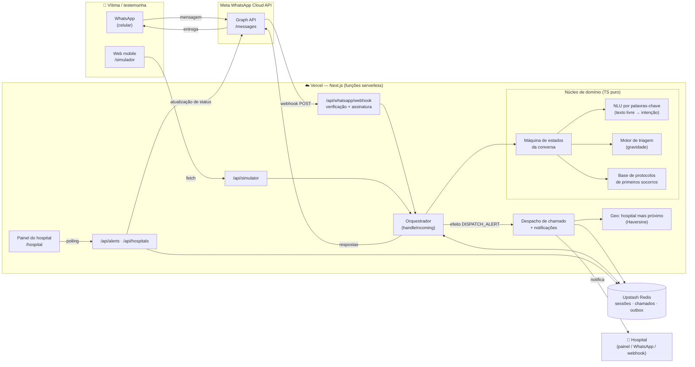
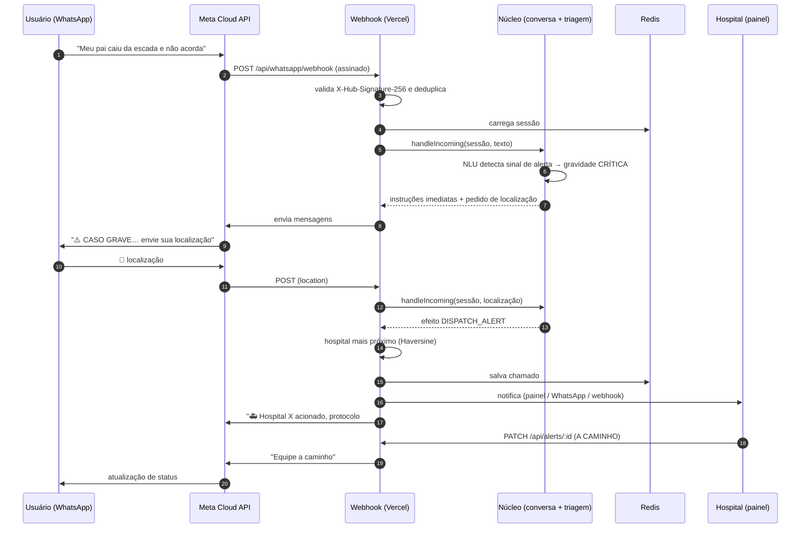
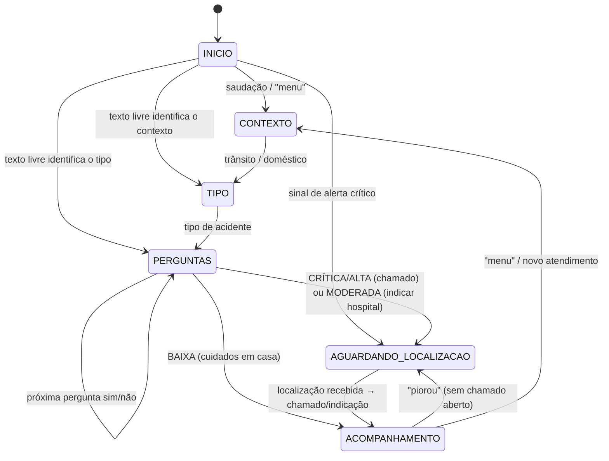
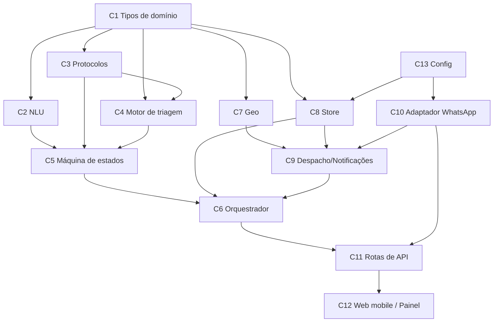
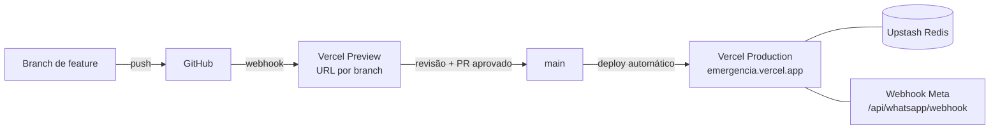

# emergencIA — Plano de Desenvolvimento

> **Produto:** chatbot no WhatsApp que orienta primeiros socorros em acidentes de trânsito e domésticos,
> avalia a gravidade do caso e, nos casos graves, **aciona automaticamente o hospital mais próximo
> compartilhando a localização da vítima**. Inclui uma aplicação web mobile (PWA) com página
> institucional, simulador do chat e painel do hospital. Deploy na [Vercel](https://vercel.com/).
>
> **Contexto acadêmico:** projeto para o FMU Tech Inovação 2026.2 (estudantes do 2º semestre),
> com foco nos itens 2 e 4 do edital (ver [docs/APRESENTACAO.md](docs/APRESENTACAO.md)).

**Como acompanhar o progresso:** cada tarefa abaixo é verificável (tem um critério de pronto
objetivo) e é marcada com `[x]` assim que concluída e validada. A coluna "Validação" diz como
conferir.

**Legenda:** `[x]` concluída · `[ ]` pendente · 🔶 opcional/evolução

---

## Sumário

1. [Arquitetura proposta](#1-arquitetura-proposta)
2. [Componentes principais e responsabilidades](#2-componentes-principais-e-responsabilidades)
3. [Stack tecnológico e justificativas](#3-stack-tecnológico-e-justificativas)
4. [Tarefas por fase](#4-tarefas-por-fase)
5. [Estimativas de tempo](#5-estimativas-de-tempo)
6. [Dependências entre componentes](#6-dependências-entre-componentes)
7. [Plano de testes e validação](#7-plano-de-testes-e-validação)
8. [Estratégia de deploy](#8-estratégia-de-deploy)
9. [Premissas, riscos e limitações](#9-premissas-riscos-e-limitações)

---

## 1. Arquitetura proposta

O repositório não tinha frontend nem backend prévios, então a solução é um **monólito modular
serverless** em Next.js: a mesma base de código entrega as páginas web mobile e as rotas de API,
e cada rota vira uma função serverless na Vercel. O núcleo de regras (triagem, conversa) é
**TypeScript puro, sem dependência de framework**, por isso é fácil de testar e de reaproveitar
em outros canais (WhatsApp, simulador web e, no futuro, Telegram ou SMS).

### Fluxo principal (caso grave)

### Estados da conversa

---

## 2. Componentes principais e responsabilidades

| # | Componente | Caminho | Responsabilidade |
|---|------------|---------|------------------|
| C1 | **Tipos de domínio** | `src/lib/domain/types.ts` | Contratos compartilhados: sessão, mensagens de entrada/saída independentes de canal, chamado, hospital, gravidade. |
| C2 | **NLU (palavras-chave)** | `src/lib/triage/nlu.ts` | Normaliza texto (acentos, caixa), detecta sinais de alerta críticos, contexto (trânsito/doméstico), tipo de acidente, sim/não e comandos (`menu`, `piorou`). |
| C3 | **Base de protocolos** | `src/lib/triage/protocols.ts` | Conteúdo de primeiros socorros por tipo de acidente, perguntas de triagem específicas e instruções imediatas para casos críticos. |
| C4 | **Motor de triagem** | `src/lib/triage/engine.ts` | Calcula a gravidade (CRÍTICA, ALTA, MODERADA, BAIXA) a partir das respostas e define a conduta (acionar hospital, indicar PS, cuidados em casa). |
| C5 | **Máquina de estados da conversa** | `src/lib/conversation/machine.ts` | Função pura `(sessão, entrada) → (nova sessão, respostas, efeitos)`. Não faz I/O. |
| C6 | **Orquestrador** | `src/lib/conversation/orchestrator.ts` | Carrega e salva a sessão, executa os efeitos (despacho de chamado) e devolve as mensagens ao canal. |
| C7 | **Geolocalização** | `src/lib/geo/*` | Distância Haversine, base de hospitais com pronto-socorro e busca dos mais próximos, links de mapa e rota. |
| C8 | **Armazenamento** | `src/lib/store/*` | Interface `Store` com implementação Upstash Redis (produção) e em memória (dev/testes): sessões com TTL, chamados, deduplicação de mensagens, outbox do simulador. |
| C9 | **Despacho e notificações** | `src/lib/alerts/*` | Cria o chamado, escolhe o hospital, notifica o hospital (painel, WhatsApp e webhook) e o usuário (WhatsApp ou outbox do simulador) quando o status muda. |
| C10 | **Adaptador WhatsApp** | `src/lib/whatsapp/*` | Converte o payload do webhook em entradas de domínio, gera os payloads da Graph API (texto, botões, lista, pedido de localização), valida a assinatura HMAC e envia as mensagens. |
| C11 | **Rotas de API** | `src/app/api/**` | Webhook do WhatsApp, simulador, chamados (lista e status), hospitais próximos, health check. |
| C12 | **Web mobile (PWA)** | `src/app/*` | Página inicial, simulador do chat (demonstração sem WhatsApp), painel do hospital com mapa e manifest PWA. |
| C13 | **Configuração** | `src/lib/config.ts` | Leitura tipada das variáveis de ambiente com valores padrão seguros. |

A documentação de cada interface fica em [docs/API.md](docs/API.md) e
[docs/ARQUITETURA.md](docs/ARQUITETURA.md), e cada módulo tem cabeçalho e comentários no código.

---

## 3. Stack tecnológico e justificativas

| Camada | Escolha | Justificativa |
|--------|---------|---------------|
| Linguagem | **TypeScript 5.9** | Tipagem estática reduz erros no fluxo de conversa (muitos estados e ramos); um só idioma no front e no back, o que facilita para uma equipe de 2º semestre. |
| Framework | **Next.js 16 (App Router)** | Front e API no mesmo projeto, suporte nativo e gratuito na Vercel (cada rota vira função serverless) e páginas responsivas com React. |
| UI | **React 19 + CSS puro** (variáveis, mobile-first) | Sem bibliotecas de UI, o bundle fica leve no 4G e há menos dependências para manter. |
| Mensageria | **Meta WhatsApp Cloud API** (oficial) | API oficial e gratuita para testes (número de teste e até 5 destinatários), com mensagens interativas (botões, listas e pedido de localização). Evita bibliotecas não oficiais (como o whatsapp-web.js), que violam os termos e derrubam o número. |
| Persistência | **Upstash Redis** (Vercel Marketplace) | Funções serverless não guardam estado entre execuções. O Redis serve via REST (bom para serverless), tem TTL nativo para sessões, plano gratuito e integração com um clique na Vercel. |
| Validação | **Zod 4** | Valida o corpo das requisições nas APIs públicas. |
| Geo | **Haversine + base local de hospitais** | Sem custo e sem chave de API, determinístico e testável. Evolução prevista: OpenStreetMap/Overpass ou CNES/DataSUS. |
| "IA" da triagem | **Sistema especialista baseado em regras** + NLU por palavras-chave | Em saúde, as regras são auditáveis e previsíveis, e cada resposta pode ser rastreada até o protocolo. 🔶 Evolução: LLM (Claude) apenas para interpretar texto livre, sempre com as regras como rede de segurança. |
| Testes | **Vitest 5** | Rápido, compatível com TypeScript, sem configuração pesada. |
| Deploy | **Vercel** | Requisito do projeto. CI/CD por git push, previews por branch, HTTPS automático (exigido pelo webhook da Meta). |

---

## 4. Tarefas por fase

### Fase 0 — Fundação e documentação

| ✔ | ID | Tarefa | Validação |
|---|----|--------|-----------|
| [x] | F0.1 | Analisar o repositório e os requisitos (repo vazio, requisitos enviados pelo usuário) | Seção 9 registra as premissas |
| [x] | F0.2 | Criar `development_plan.md` | Este arquivo |
| [x] | F0.3 | Configurar o projeto Next.js + TypeScript + Vitest (`package.json`, `tsconfig`, `next.config`) | `npm run lint` sem erros |
| [x] | F0.4 | `.env.example` documentado e `.gitignore` | Arquivo presente com todas as variáveis |
| [ ] | F0.5 | README com visão geral, como rodar e links para os docs | README atualizado |

### Fase 1 — Núcleo de triagem e conversa (backend puro)

| ✔ | ID | Tarefa | Validação |
|---|----|--------|-----------|
| [x] | F1.1 | Tipos de domínio (C1) | Compila |
| [x] | F1.2 | NLU: normalização, sinais de alerta, contexto, tipo, sim/não e comandos (C2) | `tests/nlu.test.ts` |
| [x] | F1.3 | Base de protocolos para 11 tipos (colisão, moto, atropelamento, queda, queimadura, corte, engasgo, choque elétrico, intoxicação, afogamento, outro) (C3) | Revisão de conteúdo + teste de integridade |
| [x] | F1.4 | Motor de triagem com 4 níveis e conduta (C4) | `tests/triage.test.ts` |
| [x] | F1.5 | Máquina de estados com atalhos (sinal crítico pula direto para a localização) (C5) | `tests/machine.test.ts` |
| [x] | F1.6 | Limites do WhatsApp respeitados (3 botões, títulos ≤ 20/24 caracteres, corpo ≤ 1024) | Teste automatizado varre todas as mensagens |

### Fase 2 — Geolocalização, persistência e chamados

| ✔ | ID | Tarefa | Validação |
|---|----|--------|-----------|
| [ ] | F2.1 | Haversine + busca dos hospitais mais próximos (C7) | `tests/geo.test.ts` |
| [ ] | F2.2 | Base inicial de hospitais com PS em São Paulo (coordenadas aproximadas, demonstração) | Arquivo `src/data/hospitals.ts` |
| [ ] | F2.3 | Interface `Store` + implementação em memória (C8) | `tests/orchestrator.test.ts` |
| [ ] | F2.4 | Implementação Upstash Redis (sessões com TTL, chamados, deduplicação, outbox) | Funciona em produção (ver F5.4) |
| [ ] | F2.5 | Despacho de chamado com protocolo legível (ex.: `EMG-4F7K2`) (C9) | Teste do orquestrador |
| [ ] | F2.6 | Notificação ao hospital: painel + WhatsApp opcional + webhook opcional | Teste com notificador falso |
| [ ] | F2.7 | Orquestrador executando efeitos e salvando sessão (C6) | `tests/orchestrator.test.ts` |
| [ ] | F2.8 | Paciente relata piora após o chamado → nota adicionada ao chamado | Teste do orquestrador |

### Fase 3 — Integração WhatsApp

| ✔ | ID | Tarefa | Validação |
|---|----|--------|-----------|
| [ ] | F3.1 | Parser do webhook (texto, botão, lista, localização) (C10) | `tests/whatsapp.test.ts` |
| [ ] | F3.2 | Gerador de payloads da Graph API (texto, botões, lista, `location_request_message`) | `tests/whatsapp.test.ts` |
| [ ] | F3.3 | Validação da assinatura `X-Hub-Signature-256` (HMAC-SHA256, comparação em tempo constante) | `tests/whatsapp.test.ts` |
| [ ] | F3.4 | `GET /api/whatsapp/webhook` (handshake `hub.verify_token`) | Teste manual com curl (docs/DEPLOY_VERCEL.md) |
| [ ] | F3.5 | `POST /api/whatsapp/webhook` com deduplicação por `message.id` | Teste manual + logs da Vercel |
| [ ] | F3.6 | Cliente de envio com tratamento de erro e log | Mensagem recebida no celular de teste |
| [ ] | F3.7 | Teste de ponta a ponta com o número de teste da Meta | Conversa completa gravada em vídeo para a apresentação |

### Fase 4 — Aplicação web mobile (PWA)

| ✔ | ID | Tarefa | Validação |
|---|----|--------|-----------|
| [ ] | F4.1 | Layout mobile-first, tema claro/escuro, acessibilidade básica (contraste, `aria-live`) | Teste visual em 375 px |
| [ ] | F4.2 | Página inicial: proposta de valor, botões "Falar no WhatsApp" e "Ligar 192", aviso legal | `npm run build` + navegação |
| [ ] | F4.3 | Simulador do chat com os mesmos fluxos e renderização de botões, listas e localização (GPS do navegador) | Conversa completa no navegador |
| [ ] | F4.4 | Painel do hospital: lista de chamados, gravidade, mapa (OpenStreetMap), rota, mudança de status e polling | Chamado do simulador aparece em até 5 s |
| [ ] | F4.5 | Atualização de status chega ao usuário (WhatsApp ou simulador) | Mensagem "equipe a caminho" no simulador |
| [ ] | F4.6 | Manifest PWA + ícone (instalável no celular) | "Adicionar à tela inicial" disponível |
| [ ] | F4.7 | Proteção do painel e das APIs de chamados por token (`DASHBOARD_TOKEN`) | 401 sem token |

### Fase 5 — Deploy na Vercel e documentação

| ✔ | ID | Tarefa | Validação |
|---|----|--------|-----------|
| [ ] | F5.1 | Guia de deploy passo a passo (`docs/DEPLOY_VERCEL.md`) | Revisão |
| [ ] | F5.2 | Guia de configuração do WhatsApp Cloud API (no mesmo guia) | Revisão |
| [ ] | F5.3 | Documentação de API e arquitetura (`docs/API.md`, `docs/ARQUITETURA.md`) | Revisão |
| [ ] | F5.4 | Criar o projeto na Vercel, conectar o GitHub e adicionar o Upstash Redis | URL `https://<projeto>.vercel.app/api/health` responde `ok` |
| [ ] | F5.5 | Configurar as variáveis de ambiente de produção | `/api/health` mostra `whatsapp: true`, `store: redis` |
| [ ] | F5.6 | Registrar o webhook na Meta apontando para a Vercel | Meta mostra "Verificado" |

> F3.7, F5.4 a F5.6 dependem das contas da equipe (Vercel, Meta Developers), por isso são
> executadas pela equipe seguindo o guia.

### Fase 6 — Apresentação para a faculdade

| ✔ | ID | Tarefa | Validação |
|---|----|--------|-----------|
| [ ] | F6.1 | Roteiro de apresentação (problema, solução, demo, tecnologia, impacto, próximos passos) em `docs/APRESENTACAO.md` | Revisão da equipe |
| [ ] | F6.2 | Roteiro da demonstração ao vivo + plano B (vídeo/simulador) | Ensaio cronometrado |
| [ ] | F6.3 | Perguntas prováveis da banca com respostas | Revisão |
| [ ] | F6.4 | Alinhar o conteúdo aos itens 2 e 4 do edital FMU Tech Inovação 2026.2 | Precisa do texto do edital (o link do SharePoint exige login da FMU) |
| [ ] | F6.5 | Montar os slides (PowerPoint/Google Slides) a partir do roteiro | Arquivo de slides |
| [ ] | F6.6 | Ensaio geral com cronômetro | Apresentação no tempo do edital |

### Fase 7 — Evoluções (pós-MVP) 🔶

| ✔ | ID | Tarefa |
|---|----|--------|
| [ ] | F7.1 | 🔶 LLM (Claude) para interpretar texto livre e áudio transcrito, com as regras como rede de segurança |
| [ ] | F7.2 | 🔶 Geocodificação de endereço digitado (quando o usuário não consegue enviar o 📍) |
| [ ] | F7.3 | 🔶 Base de hospitais oficial (CNES/DataSUS) e filtro por especialidade (queimados, trauma, pediatria) |
| [ ] | F7.4 | 🔶 Login por hospital (cada hospital vê só os seus chamados) |
| [ ] | F7.5 | 🔶 Integração com a Central de Regulação do SAMU 192 (exige convênio com o poder público) |
| [ ] | F7.6 | 🔶 Rate limiting, política de retenção LGPD (apagar dados após N dias) e trilha de auditoria |
| [ ] | F7.7 | 🔶 Testes E2E com Playwright no simulador |

---

## 5. Estimativas de tempo

Estimativas para **uma equipe de 3 a 4 estudantes do 2º semestre** com cerca de 6 h por pessoa por
semana. "h" são horas de trabalho somadas.

| Fase | Esforço | Duração no calendário | Situação |
|------|---------|-----------------------|----------|
| F0 — Fundação | 4 h | 2 dias | ⏳ pendente |
| F1 — Núcleo de triagem e conversa | 14 h | 1 semana | ⏳ pendente |
| F2 — Geo, persistência e chamados | 10 h | 1 semana | ⏳ pendente |
| F3 — Integração WhatsApp | 10 h | 1 semana | ⏳ pendente |
| F4 — Web mobile (PWA) | 12 h | 1 semana | ⏳ pendente |
| F5 — Deploy e documentação | 6 h | 2 a 3 dias | ⏳ pendente |
| F6 — Apresentação | 8 h | 1 semana | ⏳ pendente |
| **Total MVP** | **≈ 64 h** | **≈ 5 a 6 semanas** | |
| F7 — Evoluções | 30 a 60 h | conforme o tempo restante | 🔶 |

---

## 6. Dependências entre componentes

**Caminho crítico:** C1 → C2/C3/C4 → C5 → C6 → C11 (webhook) → deploy na Vercel → registro do
webhook na Meta → demonstração. A web mobile (C12) pode ser feita em paralelo assim que as rotas
existirem, e o simulador permite apresentar o projeto mesmo sem as credenciais da Meta.

**Dependências externas:** conta Meta Developers (WhatsApp Cloud API), conta Vercel, Upstash
Redis (pela Vercel) e o texto do edital.

---

## 7. Plano de testes e validação

### 7.1 Testes automatizados (`npm test`)

| Suíte | Cobre | Exemplos de casos |
|-------|-------|-------------------|
| `tests/nlu.test.ts` | C2 | "ele NÃO ESTÁ RESPIRANDO" → crítico; "bati o carro" → trânsito/colisão; "sim"/"ñ"/"nao" |
| `tests/triage.test.ts` | C4 | Inconsciente → CRÍTICA; atropelamento → no mínimo ALTA; corte superficial → BAIXA; presos nas ferragens → CRÍTICA |
| `tests/machine.test.ts` | C5 + C3 | Fluxo completo por botões; atalho por texto livre; "menu" reinicia; limites do WhatsApp em todas as mensagens geradas |
| `tests/geo.test.ts` | C7 | Distância conhecida SP–RJ ≈ 357 km; ordenação dos hospitais mais próximos |
| `tests/whatsapp.test.ts` | C10 | Parse de texto, botão, lista e localização; payloads; assinatura válida e inválida |
| `tests/orchestrator.test.ts` | C6 + C8 + C9 | Caso grave gera chamado com hospital mais próximo; caso moderado não gera chamado; piora adiciona nota; deduplicação |

**Critério de aceite do MVP:** todas as suítes verdes, `npm run lint` (tsc) sem erros e
`npm run build` concluído.

### 7.2 Testes manuais / aceitação

| Cenário | Passos | Resultado esperado |
|---------|--------|--------------------|
| A1 — Grave por texto livre | Simulador: "minha mãe caiu e não acorda" → compartilhar localização | Instruções imediatas, chamado no painel em até 5 s com mapa e protocolo |
| A2 — Grave por menu | Trânsito → Atropelamento → responder | Gravidade ALTA, pedido de localização, chamado aberto |
| A3 — Moderado | Doméstico → Queimadura pequena | Orientações e indicação de hospital **sem** chamado |
| A4 — Leve | Doméstico → Corte superficial | Cuidados em casa + sinais de alerta |
| A5 — Atualização de status | Painel: "A caminho" | Usuário recebe a mensagem |
| A6 — WhatsApp real | Mesmo fluxo A1 no número de teste | Idêntico ao simulador |
| A7 — Segurança | `GET /api/alerts` sem token (com `DASHBOARD_TOKEN` definido) | 401 |
| A8 — Assinatura | POST no webhook com assinatura inválida | 401, nada processado |

### 7.3 Validação de conteúdo

Os protocolos de primeiros socorros seguem as orientações públicas de primeiros socorros
(Ministério da Saúde/SAMU, Cruz Vermelha, diretrizes de RCP da AHA). **Antes de qualquer uso real,
o conteúdo precisa ser revisado por profissional de saúde** (sugestão: professor(a) da área de
saúde da FMU). Toda mensagem final reforça: *"Estas orientações não substituem atendimento
médico. Em emergência ligue 192 (SAMU) ou 193 (Bombeiros)."*

---

## 8. Estratégia de deploy

1. **Ambientes:** *Development* (`npm run dev` + armazenamento em memória), *Preview* (cada
   branch ou PR ganha uma URL própria) e *Production* (branch `main`).
2. **Persistência:** Upstash Redis adicionado pela aba *Storage / Marketplace* da Vercel, que
   injeta as variáveis automaticamente.
3. **Segredos:** todos em *Settings → Environment Variables* da Vercel, nunca no git. O
   `.env.example` documenta cada um.
4. **Webhook:** a Meta exige HTTPS público, e a URL de produção da Vercel atende. O webhook é
   registrado só em produção, para evitar que previews respondam a usuários reais.
5. **Observabilidade:** logs das funções na aba *Logs* da Vercel e `GET /api/health` para conferir
   a configuração sem expor segredos.
6. **Rollback:** *Deployments → Promote to Production* em um deploy anterior (instantâneo).
7. **Região:** `gru1` (São Paulo) em `vercel.json`, para menor latência no Brasil.

Passo a passo completo: [docs/DEPLOY_VERCEL.md](docs/DEPLOY_VERCEL.md).

---

## 9. Premissas, riscos e limitações

**Premissas** (o repositório estava vazio e não havia PRD nem especificação funcional):

- Público: vítimas ou testemunhas de acidentes de trânsito e domésticos no Brasil, com celular e
  WhatsApp.
- "Chamado automático ao hospital" = registro do chamado no **painel do hospital parceiro**, com
  localização, gravidade, tipo e telefone de contato, mais aviso opcional por WhatsApp ou webhook.
  Na demonstração, um integrante da equipe faz o papel do hospital.
- A base de hospitais é de **demonstração** (hospitais com PS em São Paulo, coordenadas
  aproximadas).

**Riscos e limitações (importante para a banca):**

| Risco | Mitigação |
|-------|-----------|
| O bot não substitui o SAMU: acionar o 192 oficialmente exige integração com a Central de Regulação (órgão público) | O bot **sempre** recomenda ligar 192/193 nos casos graves. A integração oficial está no roadmap (F7.5) como parceria |
| Orientação errada pode causar dano | Regras determinísticas e auditáveis, conteúdo revisado por profissional, aviso legal em todas as mensagens |
| Dados sensíveis (saúde + localização) — LGPD | Consentimento explícito antes de pedir a localização, dados mínimos, TTL de 24 h nas sessões, token no painel (F7.6: retenção e auditoria) |
| Usuário não consegue enviar o 📍 | Aceita endereço digitado e encaminha o chamado ao hospital de referência (F7.2: geocodificação) |
| Limites da conta de teste da Meta (5 números) | Simulador web para a demonstração; verificação do negócio para produção |
| Falso alarme / trote | Protocolo rastreável pelo telefone do WhatsApp; status "Encerrado" no painel |
